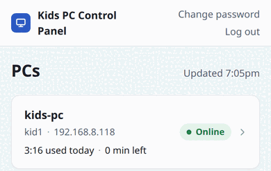
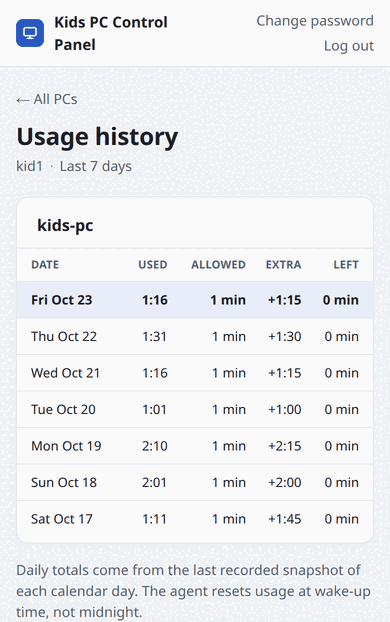
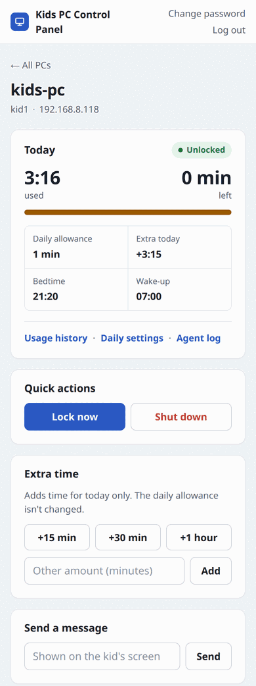
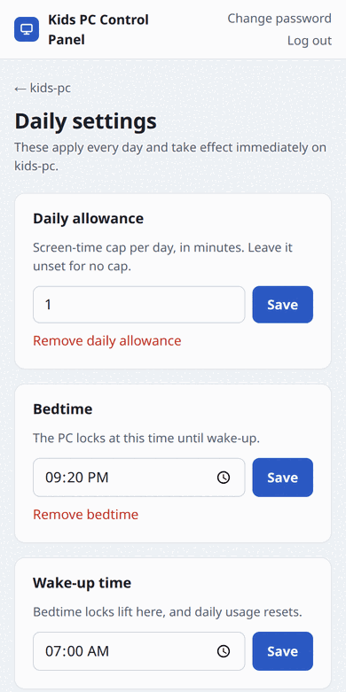

# Kid PC Monitor

DIY parental control system for tech-savvy parents. The kid's PC runs one Windows program. The parent runs a web panel on Windows, Linux, or macOS.


## 🎯 Features

- **📱 Control from your phone** - Web interface works on any device
- **🔒 Remote lock/unlock detection** - See if kids' PCs are locked
- **⏰ Scheduled bedtime locks** - Automatically lock at set times
- **⏱️ Daily usage limits** - Set maximum screen time
- **💬 Send messages** - Display warnings or reminders
- **🏠 Auto-discovery** - Kid agents find the parent web panel on your LAN
- **⏰ Grace period warnings** - 30, 15, 5, and 1-minute warnings before locks
- **💾 Persistent settings** - Limits survive PC restarts
- **👤 User-specific restrictions** - Monitor only specific Windows accounts
- **📊 Real-time status** - See current limits and time remaining

This project began as a Python fork of rookie7799's implementation. The
programs here are the Go port of that code. Python is no longer in the tree
and is not a way to build or run it. The installers still replace an existing
Python agent or panel in place, keeping the same tasks, settings, database
and shared secret. Thank you to rookie7799 for the starting point. As a fork,
they have no responsibility for any problems with this version.


## ⚠️ Technical Skills Required

This is NOT a one-click solution. You'll need to:
- Use a terminal / command prompt
- Understand IP addresses
- Open firewall ports where needed
- Set up a Windows scheduled task (the installer does this)

Release installs download a program. Building from a checkout of this
repository needs [Go](https://go.dev/dl/) 1.26 or later.

If these terms are unfamiliar or you don't want to spend the time, consider commercial alternatives like:
- Qustodio
- Net Nanny
- Windows Family Safety

## Quick Setup

This is the most common scenario.  For others, see below.

You need:

* One or more Windows PCs used by your child
* One parent Windows PC (For Mac/Linux see below)
* Both on the same home network

### Before You Start

**The kid's PC needs nothing installed first** — no Go, no Git. The agent is
a single compiled program that the installer downloads.

**On the parent computer:** the web-panel installer downloads
`kid-pc-web-panel` the same way. Building from a checkout needs Go 1.26+.

### On the Kid’s PC

Log in as an Admin user and open PowerShell with **Run as administrator**.

Run:
```powershell
[Net.ServicePointManager]::SecurityProtocol = 'Tls12'
Invoke-WebRequest https://github.com/cpmurphy/kid-pc-monitor/releases/latest/download/install_agent.ps1 -OutFile $env:TEMP\install_agent.ps1 -UseBasicParsing
powershell -ExecutionPolicy Bypass -File $env:TEMP\install_agent.ps1
```

(Or download `install_agent.ps1` from the
[latest release](https://github.com/cpmurphy/kid-pc-monitor/releases/latest)
in a browser and run the last line with its path.)

The install script walks you through the installation.
For this setup, you want to:

 1. Choose the first option, `Create/Update scheduled task`.
 2. Enter the kid's username when asked.
 3. Enter the regular bed time, wake-up time and daily time allowance.
 4. Enter the shared secret (use the same one when you install the web panel).
 5. Answer **Y** to install updates automatically (recommended).

The installer downloads the agent, `kid-pc-agent.exe`, from the same release and
checks it against the release's `SHA256SUMS` before installing it. The released
program is not code-signed, so SmartScreen or antivirus may warn about it.

Everything ends up in `C:\ProgramData\KidPCMonitor`: the agent, a copy of the
installer and `update.cmd`, so later updates and uninstalling need nothing
else (see [Updating](#-updating-this-fork)).

Options: `-Version v1.1.0` (a specific release), `-AgentExe <path>` (install a
file you already have), `-Install` / `-Uninstall` (skip the menu).

<details>
<summary>Installing from a checkout (building with Go)</summary>

From a clone of this repository, `scripts\install_agent.ps1` builds the agent
with [Go](https://go.dev/dl/) when Go is installed (add `-Download` to use the
release anyway), so a self-built program avoids the SmartScreen warning.
`update.bat` in the checkout then pulls and rebuilds.

```powershell
git clone https://github.com/cpmurphy/kid-pc-monitor.git
cd kid-pc-monitor
powershell -ExecutionPolicy Bypass -File scripts\install_agent.ps1
```
</details>

<details>
<summary>Replacing an older Python agent</summary>

Just run `install_agent.ps1` as above. It replaces that agent's task in
place, keeps its schedule, usage and shared secret, and removes its files
from `C:\ProgramData\KidPCMonitor`.
</details>
 

### On the parent PC

Open PowerShell **as administrator** and run the web-panel installer from the
[latest release](https://github.com/cpmurphy/kid-pc-monitor/releases/latest)
(or `scripts\install_web_panel.ps1` in a checkout):

```powershell
[Net.ServicePointManager]::SecurityProtocol = 'Tls12'
Invoke-WebRequest https://github.com/cpmurphy/kid-pc-monitor/releases/latest/download/install_web_panel.ps1 -OutFile $env:TEMP\install_web_panel.ps1 -UseBasicParsing
powershell -ExecutionPolicy Bypass -File $env:TEMP\install_web_panel.ps1
```

Then

Open this on your phone or laptop:

http://`<IP address of parent's PC>`:5000

**iPhone password autofill:** Safari only auto-fills saved passwords over trusted HTTPS. For one-tap login from your phone, see [Safari autofill in the FAQ](docs/FAQ.md#safari-on-iphone-wont-autofill-my-saved-password).

#### How to Find Your PC's IP Address

Open Powershell and type:

```powershell
ipconfig
```

You'll want the line that says `IPv4 Address`,

```powershell
IPv4 Address . . . . . . . . . . : 192.168.x.x
```

## To Uninstall

### On the Kid’s PC

From an administrator PowerShell:

```powershell
powershell -ExecutionPolicy Bypass -File C:\ProgramData\KidPCMonitor\install_agent.ps1 -Uninstall
```

This removes the agent's scheduled task and the automatic-update task. (Or run
it without `-Uninstall` and choose option 2, `Remove scheduled task`.)

### On the Parent’s PC

From an administrator PowerShell, run `install_web_panel.ps1` again and choose
`Remove scheduled task`, or pass `-Uninstall`. On Linux,
`./scripts/install_web_panel_linux.sh uninstall`.

## 🔄 Updating (this fork)

Updates install the latest release from GitHub (checked against its
`SHA256SUMS`) and restart the agent. When the newest release is already
installed nothing happens, so the agent is not restarted needlessly. No Git or
repository is needed.

- **Automatic (recommended):** answer **Y** when the installer offers it, or
  run `C:\ProgramData\KidPCMonitor\update.cmd auto` once. The PC then checks
  for a new release about 2 minutes after each startup and daily at 4am. Turn
  it off with `update.cmd auto-off`.
- **One-click:** double-click **`C:\ProgramData\KidPCMonitor\update.cmd`**. It
  asks for administrator rights, then updates.
- **By hand:** from an administrator PowerShell,
  `powershell -ExecutionPolicy Bypass -File C:\ProgramData\KidPCMonitor\install_agent.ps1 -Update`.

Each update also refreshes the installer copy in `C:\ProgramData\KidPCMonitor`
from the same release. The agent logs its version when it starts
(`version=v1.1.0` in `pc_control.log`), so you can check which release is
running.

If you installed from a checkout, `update.bat` in the repository folder still
pulls and rebuilds (`update.bat auto` / `auto-off` for automatic updates).

The **parent web panel** updates the same way: re-run `install_web_panel.ps1`
on Windows, or `./scripts/install_web_panel_linux.sh install` on Linux. A
checkout with Go rebuilds the panel; otherwise the installer downloads the
latest release and checks `SHA256SUMS`.

## 📸 Screenshots

<table>
  <tr>
    <td valign="top" width="33%">
      <br><br>
      
    </td>
    <td valign="top" width="33%">
      
    </td>
    <td valign="top" width="33%">
      
    </td>
  </tr>
</table>

## Prerequisites

To use this tool effectively, you'll want to have a separate parent/admin
machine to run the web interface.

- **Kid's PCs:** Windows 10/11 (the monitoring agent uses Windows APIs)
- **Parent / admin machine:** Windows, Linux, or macOS. The web panel is `kid-pc-web-panel` and listens on TCP **5000**. Building it from a checkout needs Go 1.26+; a release install downloads the program.

## Network Considerations

Current agents make outbound connections to the parent web panel: HTTP discovery
on TCP **5000**, then a native protocol TCP session on **9998** (configurable).
Kid PCs do not need an inbound listen port for web-panel control, which avoids
the common Windows Firewall problem where the agent is running but blocked from
the parent side.

The parent computer and kid computers usually need to be:

* on the same home Wi-Fi network
* able to reach the parent web panel at `http://<parent-pc-ip>:5000`
* able to reach the reverse control port at `tcp://<parent-pc-ip>:9998`

The web panel host must allow inbound TCP **5000** (browsers + discovery) and
**9998** (agent reverse control) from the LAN. Many machines have no active
firewall and need nothing; the Linux installer checks for you. With ufw, for example:

```bash
sudo ufw allow 5000/tcp
sudo ufw allow 9998/tcp
```

<details>
<summary>Agent discovery (Technical Details)</summary>
Agents first try `KID_PC_MONITOR_PANEL_URL` if set, then their cached panel URL,
then scan their local `/24` for the web panel discovery endpoint on TCP 5000.
They open reverse control on the `reverse_port` advertised by discovery
(default 9998). The panel never dials kid PCs; connected agents appear in the
UI as they call home.
</details>

## Installation

Installation is in two parts.  You install the agent on the kid's PC (as
many PCs and as many accounts as needed) and you install the admin UI on
a computer you control.

## Option A -- Separate Kid and Parent PCs

### Kid's PC

Only Windows is supported currently.

```powershell
<# In PowerShell opened with "Run as administrator" #>
[Net.ServicePointManager]::SecurityProtocol = 'Tls12'
Invoke-WebRequest https://github.com/cpmurphy/kid-pc-monitor/releases/latest/download/install_agent.ps1 -OutFile $env:TEMP\install_agent.ps1 -UseBasicParsing
powershell -ExecutionPolicy Bypass -File $env:TEMP\install_agent.ps1
```

Run the installer from an administrator account and, when prompted,
enter the **child's Windows username**. The agent then launches in that
child's session at their logon. Specifics:
- The agent, `kid-pc-agent.exe`, installs to `C:\ProgramData\KidPCMonitor`. That folder is restricted to SYSTEM and Administrators (full control) and the child account (read and execute), so the child can't change or replace anything in it.
- The scheduled task runs at the child's logon only, with `LeastPrivilege` (no UAC prompt for the kid), and starts enforcing immediately.
- The agent writes its log and state to `%LOCALAPPDATA%\KidPCMonitor` in the child's profile. If the child has never signed in, the schedule is kept in ProgramData and applied at their first logon.

You may also enter your **own** username to monitor the account you are
signed in as. This is the weakest setup — the agent runs unelevated, so
that account can stop the task and undo locks — so the installer warns
and asks you to confirm.

The agent connects outbound to the parent web panel (discovery on TCP **5000**,
reverse control on TCP **9998**). No inbound Windows Firewall rule is required
on the kid PC.

### Parent's PC

Run the web panel on a separate PC (your own computer). More secure since kids can't access the admin interface.

The web panel is one program, `kid-pc-web-panel`, for Windows, Linux and
macOS. It is published with every release. If an older Python panel is
already installed, the installer replaces its task and keeps the database,
password and shared secret. Log in once more in the browser after that
(the session cookie does not carry over).

#### On your Windows PC

Download `install_web_panel.ps1` from the
[latest release](https://github.com/cpmurphy/kid-pc-monitor/releases/latest)
(or use `scripts\install_web_panel.ps1` in a checkout) and run it from an
administrator PowerShell:

```powershell
powershell -ExecutionPolicy Bypass -File install_web_panel.ps1
```

It downloads `kid-pc-web-panel.exe` for your PC (checked against the
release's `SHA256SUMS`; with Go installed and a checkout it builds it
instead), asks for the shared secret unless one is already stored, and
offers firewall rules for TCP 5000 and 9998. The panel runs in the background
and logs to `%LOCALAPPDATA%\kid-pc-monitor\web_panel.log`. Run it again to
update; `-Uninstall` removes it.

#### Linux

On a Linux box with systemd, the installer builds the panel when Go and this
checkout are present, otherwise downloads the release and checks it, asks
for the shared secret, and starts it as a background service.

```bash
git clone https://github.com/cpmurphy/kid-pc-monitor.git
cd kid-pc-monitor
./scripts/install_web_panel_linux.sh install
```

`install --go` is the same command. `--binary PATH` installs a binary you
already have; `--version v1.2.3` picks a release.

After starting the service it checks two things and only suggests changes
when they are actually needed:

- **Start at boot** — if systemd "lingering" is off for your account, the
  panel would only run while you are logged in; it offers to run
  `sudo loginctl enable-linger $USER`.
- **Firewall** — it looks for an active firewalld, ufw, or nftables/iptables
  service and checks whether TCP 5000 and 9998 are already allowed. If a
  firewall blocks them it shows (and offers to run) the exact commands; if
  there is no active firewall it tells you no changes are needed.

Other commands: `status`, `uninstall`, and `cat-unit` (preview the unit file).
Re-run `install` to update and restart the panel.

#### macOS

Download `kid-pc-web-panel-darwin-arm64` (Apple silicon) or
`-darwin-amd64` (Intel) from the release, then:

```bash
chmod +x kid-pc-web-panel-darwin-arm64
xattr -d com.apple.quarantine kid-pc-web-panel-darwin-arm64  # if your browser downloaded it
./kid-pc-web-panel-darwin-arm64 set-secret
./kid-pc-web-panel-darwin-arm64
```

Allow incoming connections when macOS asks. To start it automatically, add
it to **System Settings → General → Login Items**.

Passwords from installs older than May 2026 lived inside the old package
folder. The Windows and Linux installers copy that file into the config
folder (or run the panel with `-legacy-auth PATH`).

## Option B: Single PC Setup

Run everything on the kid's PC and access the admin panel from your
phone. Convenient if you don't have a separate PC always running.

1. **On the kid's PC (as administrator):** install the agent with
   `install_agent.ps1`, then the web panel with `install_web_panel.ps1`
   (both are on the [latest release](https://github.com/cpmurphy/kid-pc-monitor/releases/latest)).

2. **On your phone:**
   - Open browser and go to `http://KIDS-PC-IP:5000`
   - Bookmark it for easy access
   - For iOS Safari password autofill hints, see [FAQ](docs/FAQ.md#safari-on-iphone-wont-autofill-my-saved-password)

Both services run in the background (`kid-pc-agent.exe` and `kid-pc-web-panel.exe`).

**Note:** With this setup, a tech-savvy child could potentially discover the web panel at `localhost:5000`. Option A is more secure.

---

*Side note: if your kid is "good" with computers, consider copying the scripts somewhere less obvious.*

## 📖 Usage Guide

### Ad-hoc Changes
1. Open the web interface on your phone
2. Click on a PC
3. View current settings in the "📊 Current Settings" section

#### Granting More Time
1. Use quick buttons to extend the time allowance for today: "30 min", "1 hour", "2 hours"
2. Or enter number of minutes for a custom time extension
3. Page refreshes to show the new time

#### Manual Lock
1. Use the "Lock Computer Now" button to do that.
2. A more extreme option, "Shutdown Computer" is also available.
3. Use the "Clear" button next to Manual lock to unlock.

### Changing Daily Settings
1. Select a PC
2. Follow the link "Daily settings"
2. Edit or remove daily allowance, bedtime and wake-up time.
4. PC will lock automatically at bedtime and stay locked until the wake-up time.

Note: when a usage limit, bedtime, or manual lock is active, the agent
re-issues the lock whenever it detects the screen has been unlocked, so
the child can't bypass it by typing their Windows password. The **Lock
Computer Now** button enables a manual lock that remains active until
you clear all limits.

## 🔧 Troubleshooting

See [docs/FAQ.md](docs/FAQ.md) for questions and answers.

### "PC shows as Unknown"
- The panel shows the hostname the agent reports
- Check Windows Firewall settings
- Ensure PCs are on same network

### Agent does not appear in the web panel
- Ensure the web panel is running (`kid-pc-web-panel`).
- Ensure the parent/web-panel host firewall allows inbound **5000/tcp** (UI + discovery) and **9998/tcp** (agent reverse control) from kid PCs.
- On the kid PC, read `%LOCALAPPDATA%\KidPCMonitor\pc_control.log` for reverse TCP and discovery messages.
- If auto-discovery fails, set `KID_PC_MONITOR_PANEL_URL=http://<parent-pc-ip>:5000` for the scheduled agent task.

### "Can't connect from phone"
- Check the web panel host firewall allows inbound **5000/tcp** and **9998/tcp**.
- Use the web panel machine's IP address, not localhost.
- Ensure the web panel is running (`kid-pc-web-panel`).

### "Lock status not updating"
- Restart the agent: in an administrator PowerShell, `Stop-ScheduledTask KidPCMonitor; Start-ScheduledTask KidPCMonitor` (it runs only while the child is signed in).
- Read `%LOCALAPPDATA%\KidPCMonitor\pc_control.log` in the child's profile.
- `go run ./cmd/wincheck status` (from `go/`, with Go installed) shows what the lock detection sees.

## 🛡️ Security Notes

- Only works on local network (not internet)
- Optional **parent web panel** password: use **Add password protection** on the home page. Only a secure hash is stored in `web_panel_auth.json` next to the app (not the plain password). Until you set one, anyone on the LAN can use the panel—the same as before this feature.
- Can't bypass Windows lock screen
- Kids can close the agent if their account has admin rights. If you install in cross-user mode (admin installs, non-admin child runs), the child cannot stop or delete the scheduled task or its files.

## 🤝 Contributing

Parents and developers welcome! Please:
1. Fork the repository
2. Create a feature branch
3. Submit a pull request

The programs are Go (`go/`, see [go/README.md](go/README.md)). Behavior that
has to stay compatible with existing installs is pinned by the frozen vectors
in `testdata/`. **Publishing a release:** push a version tag (`git tag v1.2.0`
then `git push origin v1.2.0`). `.github/workflows/release.yml` runs CI, then
attaches the agent and web-panel binaries, `install_agent.ps1`,
`install_web_panel.ps1` and `SHA256SUMS` to that tag's release.

### Recent Improvements
- ✅ **Single programs** — The kid's PC and the parent panel are compiled Go programs. Released builds, checksum-verified installs, locked-down agent folder, enforcement from the first second of logon
- ✅ **Mutual authentication** — HMAC-signed agent protocol (v3); shared secret stored encrypted at rest
- ✅ **Web panel security** — Optional password login; CSRF protection on state-changing actions
- ✅ **Linux/macOS parent support** — Run the web panel on non-Windows machines; systemd user-service installer
- ✅ **Cross-user install** — Admin installs the agent; the child's non-admin account runs it (harder to bypass)
- ✅ **Wake-up time** — Bedtime curfew ends at wake-up, not midnight; configurable in the web panel and at install
- ✅ **Smarter time tracking** — Only active use counts toward the daily allowance; locked sessions stop the clock
- ✅ **Lock hardening** — Re-locks automatically if the kid unlocks while a limit is active; persistent manual locks
- ✅ **Grace period warnings** — 30, 15, 5, and 1-minute warnings before lock; warnings reset after a time extension
- ✅ **Reverse agent TCP** — Agents call home with the native protocol, avoiding inbound kid-PC firewall issues
- ✅ **Live PC status** — Background status refresh with SQLite snapshot history; last-known state when a PC goes offline
- ✅ **IP address changes** — Control pages keyed by hostname so DHCP changes do not break bookmarks
- ✅ **Agent log viewer** — View agent logs remotely from the web panel
- ✅ **Easier reinstall** — Installer reuses previous settings

### Ideas for Future Contributions
- Linux/macOS **agent** (kid-side monitoring; the web panel already runs on Linux/macOS/Windows)
- Mobile app
- Usage statistics/reports
- Reward system integration
- Application-specific time limits

## 📄 License

MIT License - feel free to modify for your family's needs!

## ❤️ Acknowledgments

Created by parents, for parents. Special thanks to all contributors who help make screen time management easier!

---

**Need Help?** Open an [issue](https://github.com/cpmurphy/kid-pc-monitor/issues) or check our [FAQ](docs/FAQ.md)
