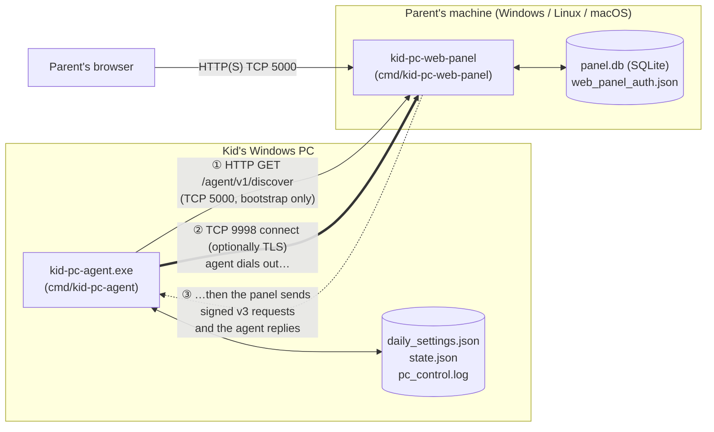
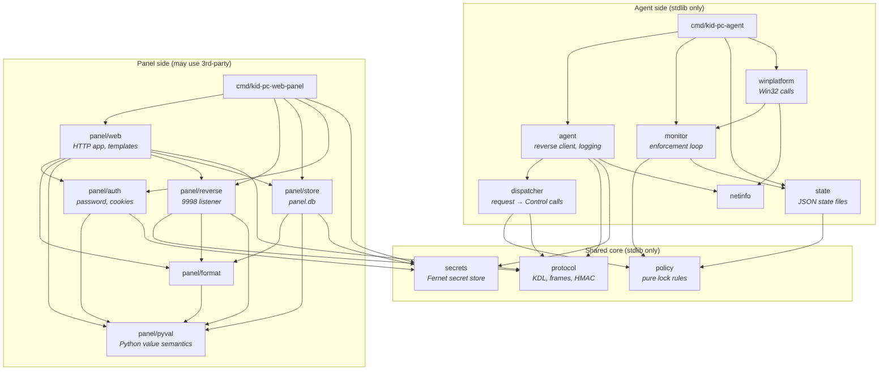
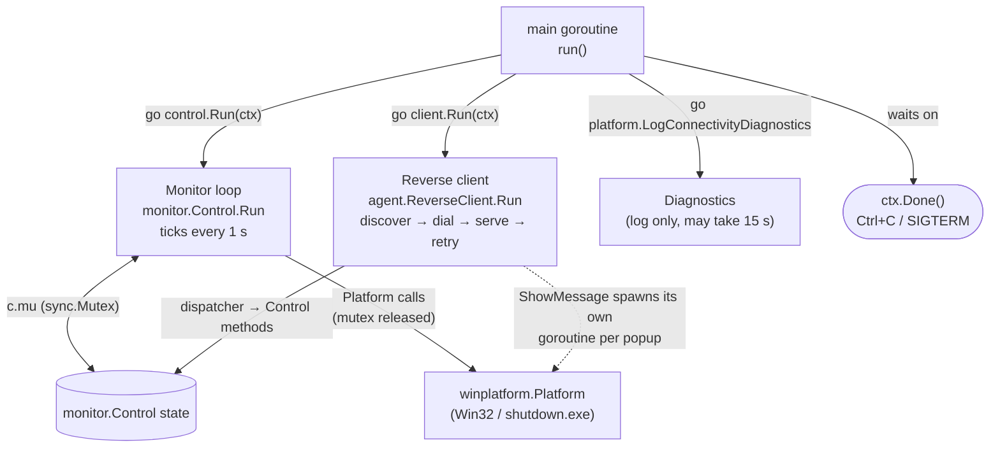
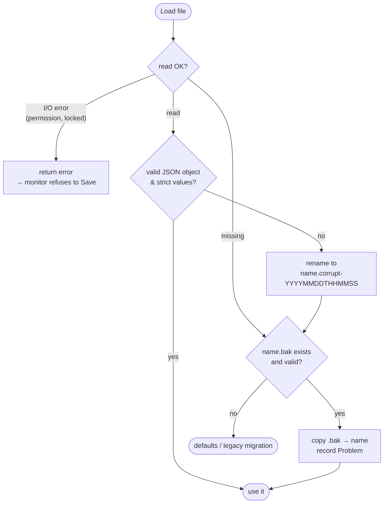
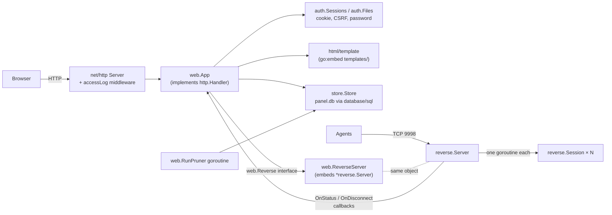
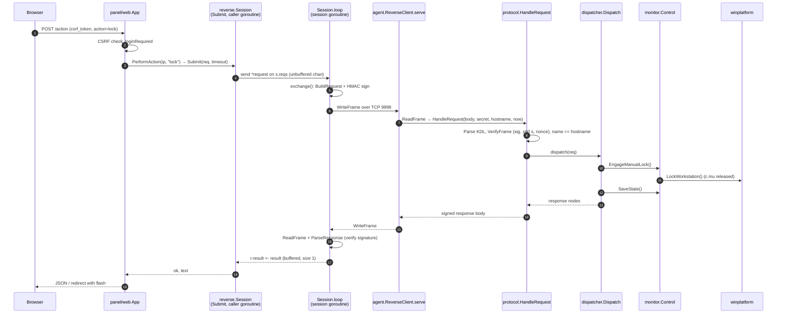
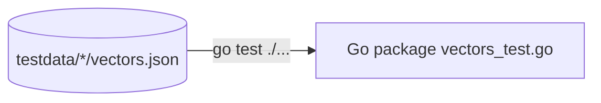
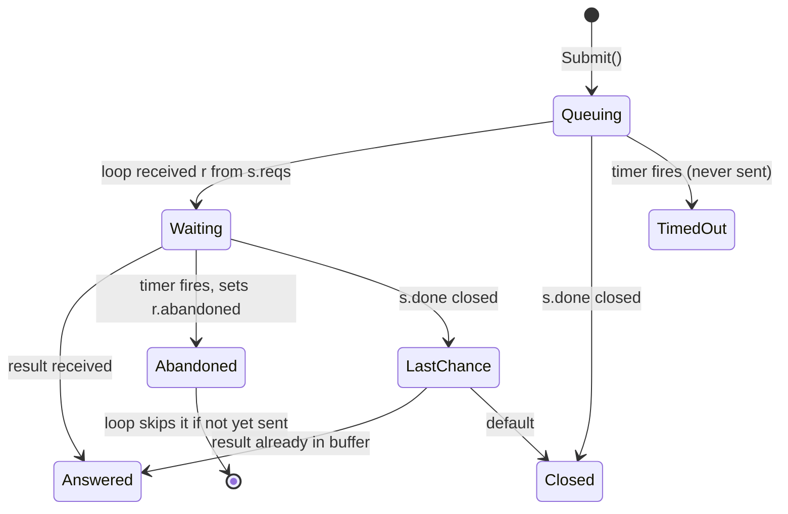

# Reading the Go Source: A Newcomer's Guide

This guide is a map of the Go code in this repository. It covers what each
package does, how the packages fit together, which Go language and
standard-library features they use (and why), and where the code is subtle
enough that you should slow down before changing it.

It does not repeat the package-level docs. Every package has a doc comment
(usually in `doc.go`) that is the authoritative description, and
[TECH.md](TECH.md) has the package table and build commands.
Read this guide first for orientation, then read those.

> **One rule to keep in mind:** this code was ported from a Python program
> that is no longer in the tree. File formats, the wire protocol, and a lot
> of code that looks odd in Go (Python-style `repr`, round-half-to-even,
> `int()` coercion) stay that way so existing installs and the frozen golden
> vectors keep working. `panel/pyval` is what lets the panel read databases
> the original program wrote. See [Golden vectors](#7-how-the-go-code-is-tested-golden-vectors).

---

## Contents

1. [The big picture](#1-the-big-picture)
2. [Two programs, one module](#2-two-programs-one-module)
3. [Package dependency map](#3-package-dependency-map)
4. [The agent (kid's PC)](#4-the-agent-kids-pc)
5. [The web panel (parent's machine)](#5-the-web-panel-parents-machine)
6. [One parent action, end to end](#6-one-parent-action-end-to-end)
7. [How the Go code is tested: golden vectors](#7-how-the-go-code-is-tested-golden-vectors)
8. [Go features field guide](#8-go-features-field-guide)
9. [Tricky and non-obvious code](#9-tricky-and-non-obvious-code)
10. [Suggested reading order](#10-suggested-reading-order)

---

## 1. The big picture

There are two programs. The **agent** runs on the kid's Windows PC and
enforces time limits. The **web panel** runs on the parent's machine and
serves the admin UI. The unusual part is the network direction: **the agent
dials out to the panel**, but once connected the *panel* sends the requests
and the *agent* answers them. The kid's PC therefore needs no inbound
firewall rule.



The wire protocol (length-prefixed frames of a small KDL subset, signed with
HMAC-SHA256) is specified in [`docs/agent-protocol.md`](agent-protocol.md).

---

## 2. Two programs, one module

Everything lives in a single Go module named `kidpcmonitor`
([`go.mod`](../go.mod)), so imports look like `kidpcmonitor/protocol`.

| Executable | Runs on | Purpose |
|---|---|---|
| [`cmd/kid-pc-agent`](../cmd/kid-pc-agent) | Windows only | Kid-side agent: enforcement loop + reverse client. |
| [`cmd/kid-pc-web-panel`](../cmd/kid-pc-web-panel) | Windows, Linux, macOS | Parent panel: HTTP UI on 5000 + reverse listener on 9998. |
| [`cmd/wincheck`](../cmd/wincheck) | Windows only | Manual test tool for `winplatform` on a real host. |

There is an important constraint between the two halves. **The agent must
build from the standard library only.** Only the panel may use third-party
modules (`modernc.org/sqlite`, a pure-Go SQLite, plus `golang.org/x/crypto`
for scrypt and `golang.org/x/term` for password prompts). CI enforces this
with `GOOS=windows go list -deps ./cmd/kid-pc-agent` (see
`.github/workflows/ci.yml`), so anything the agent imports must stay
dependency-free.

---

## 3. Package dependency map

Arrows point from importer to imported. Packages shared by both programs are
in the middle.



Two things to notice:

* **`winplatform` imports `monitor`, not the other way round.** `monitor`
  defines the `Platform` interface it needs, and `winplatform` implements it.
  That keeps `monitor` free of Windows code, so its tests run on Linux with a
  fake. This is the usual Go pattern: *the consumer defines the interface*.
  `dispatcher.Control` (implemented by `monitor.Control`) and `web.Reverse`
  (implemented by `web.ReverseServer`) follow the same pattern.
* **`protocol` sits in the middle.** The agent uses it as a *server*
  (`HandleRequest`). The panel uses it as a *client* (`BuildRequest`,
  `ParseResponse`). It is one implementation of the spec used from both ends.

---

## 4. The agent (kid's PC)

### 4.1 What runs, and on which goroutine

[`cmd/kid-pc-agent/main.go`](../cmd/kid-pc-agent/main.go) wires the pieces
together and starts three goroutines. One `context.Context`, created by
`signal.NotifyContext`, is the stop signal for all of them.



The monitor loop and the reverse client both touch the same
`monitor.Control`, so every exported `Control` method takes `c.mu`. See
[§9.1](#91-the-monitor-releases-its-lock-around-platform-calls) for the
unusual part of that locking.

### 4.2 Packages, in the order a request touches them

| Package | Role | Start reading at |
|---|---|---|
| `agent` | Finds the panel (env var, then `panel_url.txt` cache, then a scan of the local /24), dials 9998 with TLS fallback, and loops reading frames. Also implements a Python-compatible rotating log on top of `log/slog`. | [`agent/reverse.go`](../agent/reverse.go) `ConnectOnce`, `serve` |
| `protocol` | Frames (`ReadFrame`/`WriteFrame`), the KDL tokenizer, parser and serializer, HMAC signing, and `HandleRequest`, which turns one request body into one signed response and never fails. | [`protocol/server.go`](../protocol/server.go) |
| `dispatcher` | Validates fields ("1–1440 minutes", "HH:MM") and maps an action to calls on the `Control` interface, then builds the response nodes. | [`dispatcher/dispatcher.go`](../dispatcher/dispatcher.go) `Dispatch` |
| `monitor` | Owns the in-memory state. `Step()` runs four independent phases each second: tick usage, send warnings, enforce lock, persist. | [`monitor/monitor.go`](../monitor/monitor.go) `Step`, `Run` |
| `policy` | Pure functions: should the PC be locked now, and how many minutes remain? No clock, no I/O. | [`policy/policy.go`](../policy/policy.go) `LockDecision` |
| `state` | Reads and writes `daily_settings.json` and `state.json` with strict validation, quarantine of corrupt files, and `.bak` restore. | [`state/store.go`](../state/store.go) `Load` |
| `winplatform` | Lock detection (WTS session flags, with a LogonUI.exe fallback), `LockWorkStation`, message boxes, `shutdown.exe`. | [`winplatform/windows.go`](../winplatform/windows.go) |
| `secrets` | Decrypts the installer's Fernet-encrypted shared secret (AES-CBC + HMAC, PBKDF2 key), implemented by hand on the standard library. | [`secrets/secrets.go`](../secrets/secrets.go) |
| `netinfo` | Finds the primary IPv4 address with a UDP "connect" that sends no packets. | [`netinfo/netinfo.go`](../netinfo/netinfo.go) |

### 4.3 State files never get silently thrown away

The `state` package's recovery logic is easiest to follow as a flowchart
([`state/store.go:196`](../state/store.go#L196) `readValidated`):



Every `Save` refreshes `.bak`, but only from a file that itself validates
(`writeJSON`, [`state/store.go:131`](../state/store.go#L131)). It then
writes `name.json.tmp` and `os.Rename`s it into place, so a crash in the
middle of a write never leaves a half-written file.

---

## 5. The web panel (parent's machine)

[`cmd/kid-pc-web-panel/main.go`](../cmd/kid-pc-web-panel/main.go) `serve()`
builds the object graph below and runs an `http.Server` on 5000 and a
`reverse.Server` on 9998 in the same process.



| Package | Role | Start reading at |
|---|---|---|
| `panel/web` | The whole Flask app re-done on `net/http`: a hand-written router that matches werkzeug's 404/405 behaviour, buffered responses, CSRF, cache headers, templates. | [`panel/web/web.go:222`](../panel/web/web.go#L222) `ServeHTTP` |
| `panel/reverse` | Accepts agent connections, identifies each with an unnamed `get settings`, keeps a per-hostname `Session`, and serializes parent actions onto it. | [`panel/reverse/server.go`](../panel/reverse/server.go) `handle`, [`session.go`](../panel/reverse/session.go) |
| `panel/store` | `panel.db`: same schema, SQL and timestamp strings as the Python panel, so either panel can take over the other's database. | [`panel/store/store.go`](../panel/store/store.go) `Open`, `tx` |
| `panel/auth` | werkzeug-compatible scrypt/pbkdf2 password hashes, an HMAC-signed session cookie, and the safe-redirect check for `?next=`. | [`panel/auth/session.go`](../panel/auth/session.go), [`hash.go`](../panel/auth/hash.go) |
| `panel/format` | Pure display helpers ("1 h 30 min"), agent settings → dashboard PC-info, and panel action → protocol fields. | [`panel/format/pcinfo.go`](../panel/format/pcinfo.go) |
| `panel/pyval` | Python semantics on `any` values: truthiness, `int()`, `str()`, `repr(float)`, `datetime.fromisoformat`. | [`panel/pyval/pyval.go`](../panel/pyval/pyval.go) |

---

## 6. One parent action, end to end

Here is what happens when the parent clicks **Lock** on the control page:



Between parent actions the session loop also sends its own `get settings`
every `StatusRefresh`. That keeps the dashboard current and doubles as a
liveness check. Because a single goroutine (`Session.loop`) owns the socket,
the request/response conversation never interleaves.

---

## 7. How the Go code is tested: golden vectors

Most Go packages have a `vectors_test.go` that loads
`testdata/<name>/vectors.json`. Those files were generated from the original
Python implementation and are now the checked-in contract. `go test` replays
every case. There is no generator: if you change behavior on purpose, edit
the JSON in the same commit.



What this means for you:

* When a test fails after you change Go code, the vectors still describe the
  previous behavior. Update them only when that change is intentional.
* Tests that need time or randomness inject them. You will see fields like
  `Clock func() time.Time`, `Now func() time.Time` and
  `LoadSecret func() (string, error)` on many structs. A nil field means "use
  the real thing". This is how `monitor` replays scripted scenarios
  deterministically ([`monitor/vectors_test.go`](../monitor/vectors_test.go)).

---

## 8. Go features field guide

This section is for readers who know another language well but are new to Go.
Each entry says what the feature is and points to a real use in this repo.

### Language features

| Feature | What it is | Where to see it |
|---|---|---|
| **Implicit interfaces** | A type satisfies an interface just by having the methods. There is no `implements` keyword. | `monitor.Platform` ([`monitor/monitor.go`](../monitor/monitor.go)) is satisfied by `winplatform.Platform` and by the test fakes. |
| **Compile-time interface check** | `var _ I = (*T)(nil)` fails to compile if `*T` stops satisfying `I`. | [`winplatform/windows.go:23`](../winplatform/windows.go#L23) |
| **Struct embedding** | An embedded field's methods are promoted onto the outer type. Used for adapters and wrappers. | `web.ReverseServer{ *reverse.Server }` ([`panel/web/reverse.go:9`](../panel/web/reverse.go#L9)) adds two methods and inherits `PerformAction`. `statusRecorder` embeds `http.ResponseWriter` and overrides only `WriteHeader` ([`cmd/kid-pc-web-panel/main.go:275`](../cmd/kid-pc-web-panel/main.go#L275)). |
| **`any` and type switches** | `any` is `interface{}`. `switch v := x.(type)` branches on the dynamic type. This repo uses it to model Python's dynamic values. | `protocol.Value = any` (a *type alias*, note the `=`) in [`protocol/compat.go:11`](../protocol/compat.go#L11). `advertisedPort` in [`agent/reverse.go`](../agent/reverse.go). All of `panel/pyval`. |
| **Pointers as "optional"** | `*int64` / `*string` / `*TimeOfDay` where Python has `None`. `nil` means unset. | `DailySettings.BedTime`, `Control.DailyAllowance() *int64`, `ProtocolError.ReqID *string`. `protocol.Ptr(s)` is a helper because you can't take `&"literal"`. |
| **Multiple returns and `(value, ok)`** | Go has no exceptions. Functions return `(result, error)` or `(result, ok bool)`. | `policy.MinutesUntilLock` returns `(float64, bool)` where Python returns `float \| None`. |
| **Custom error types + `errors.As` / `errors.Is`** | Errors are values. `errors.As` unwraps a chain to find a specific type. `fmt.Errorf("…%w", err)` wraps. | `*protocol.ProtocolError` carries a wire error code ([`protocol/errors.go`](../protocol/errors.go)). `HandleRequest` uses `errors.As` to choose between that code and `internal_error`. |
| **`defer`** | Runs when the function returns. Used for unlocks, closes, and cleanup. Runs in LIFO order. | `c.mu.Lock(); defer c.mu.Unlock()` throughout `monitor`. Note the four stacked defers in `reverse.Server.Serve` ([`panel/reverse/server.go:164`](../panel/reverse/server.go#L164)): sessions close *before* `wg.Wait()`. |
| **`panic` / `recover`** | `recover()` inside a deferred func stops a panic. It is used here only as a safety net so one bug can't stop enforcement or the server. | `runPhase` ([`monitor/monitor.go:454`](../monitor/monitor.go#L454)), `ReverseClient.cycle` ([`agent/reverse.go:95`](../agent/reverse.go#L95)), `App.ServeHTTP`, `emitStatus`. |
| **Named results modified in `defer`** | A deferred closure can assign to a named return value after a panic. | `cycle(ctx) (delay time.Duration)` sets `delay = cycleFailureRetry` in its `recover` block. |
| **Generics** | Type parameters `[T any]`. Used sparingly. | `readValidated[T any]` ([`state/store.go:196`](../state/store.go#L196)) handles both state files with one recovery routine. |
| **Newer built-ins** | `min`, `max` (Go 1.21), `clear(map)` (1.21), `for range n` over an int (1.22). | `clear(c.warningsSent)` in `monitor`, `min(d, reconnectMax)` in `agent`, `for range length` in [`panel/auth/hash.go`](../panel/auth/hash.go). |
| **Function values as fields** | Dependency injection without a framework. | `Config.Clock`, `ReverseClient.LoadSecret`, `reverse.Server.OnStatus`, the `protocol.Dispatcher` func type, and `dispatcher.Handler(c)`, which returns a closure. |
| **Package-level initializer expressions** | `var x = func() T { … }()` runs once at program start. | `systemDir` ([`winplatform/windows.go:227`](../winplatform/windows.go#L227)) is computed before the lazy DLLs that depend on it. |
| **`iota`** | Auto-incrementing constants for enums. | `tokKind` in [`protocol/kdl.go:126`](../protocol/kdl.go#L126). |
| **Struct tags** | Backtick metadata read by `encoding/json` (`json:"a,omitempty"`). | `sessionData` in [`panel/auth/session.go`](../panel/auth/session.go) uses one-letter keys to keep the cookie short. |

### Concurrency

| Feature | What it is | Where to see it |
|---|---|---|
| **Goroutines** | `go f()` starts a lightweight thread. | Three in agent `main`. One per agent connection in `reverse.Server.Serve`. One per popup in `ShowMessage`. |
| **Channels + `select`** | Typed queues. `select` waits on several of them at once. A `chan struct{}` that gets `close`d is a broadcast "done" signal. | `Session.Submit` / `Session.loop` ([`panel/reverse/session.go`](../panel/reverse/session.go)) are the richest example. Agent `main` uses `monitorDone`/`clientDone` to wait for shutdown. |
| **Buffered vs unbuffered channels** | Unbuffered sends wait for a receiver. A buffer of 1 lets the sender continue even if nobody reads. | `s.reqs` is unbuffered, so the handoff is a rendezvous. `r.result` has capacity 1, so the session loop never blocks on a caller that has already timed out. |
| **`context.Context`** | Cancellation and deadlines passed down the call chain. | `signal.NotifyContext` in both `main`s. `context.WithTimeout` around TLS handshakes and `shutdown.exe`. `http.NewRequestWithContext` for discovery. |
| **`context.AfterFunc`** (Go 1.21) | Runs a callback when a context is cancelled. Useful for unblocking a blocking `Read`/`Accept` by closing the socket. | [`agent/reverse.go:167`](../agent/reverse.go#L167), [`panel/reverse/server.go:165`](../panel/reverse/server.go#L165) |
| **`sync.Mutex` / `RWMutex`** | Locks. No re-entrancy: locking twice on one goroutine deadlocks. | `monitor.Control.mu`, `store.Store.writeMu`, `auth.Sessions.mu` (RW). |
| **`sync.Once` / `sync.OnceValue`** | Run exactly once. `OnceValue` (1.21) also caches the return value. | `Session.closeOnce` (close `done` + conn once). `serve`'s `closeConn`. `flagsInverted` ([`winplatform/windows.go:330`](../winplatform/windows.go#L330)). |
| **`sync.WaitGroup`** | Wait for a set of goroutines to finish. | `reverse.Server.Serve` waits for every session goroutine before returning. |
| **`sync/atomic`** | Lock-free flags. | `request.abandoned atomic.Bool`, set by a timed-out caller and read by the session loop. |
| **`time.Ticker` / `time.Timer` / `time.After`** | Periodic and one-shot timers that deliver on a channel. | `Control.Run` (1 s ticker). `Session.loop` (idle refresh timer, `Reset` after each event). The `ReverseClient.Run` back-off. |

### Standard library highlights

| Package | Why it matters here | Where |
|---|---|---|
| `log/slog` | Structured logging. The agent plugs in a **custom `slog.Handler`** that writes Python `logging`-format lines, so the panel's log page parses them the same way. | `pyHandler` in [`agent/logging.go:197`](../agent/logging.go#L197). Panel uses the stock `slog.NewTextHandler`. |
| `syscall` + `unsafe` | Calling Win32 without cgo or `x/sys/windows`: `syscall.NewLazyDLL(...).NewProc(...).Call(uintptr...)`. | [`winplatform/windows.go`](../winplatform/windows.go), [`cmd/kid-pc-web-panel/console_windows.go`](../cmd/kid-pc-web-panel/console_windows.go) |
| `runtime.LockOSThread` | Pins a goroutine to one OS thread. Win32 UI calls such as `MessageBox` assume thread affinity. | `ShowMessage` ([`winplatform/windows.go:141`](../winplatform/windows.go#L141)) |
| `os/exec` + `SysProcAttr` | Running `shutdown.exe` with `HideWindow` / `CREATE_NO_WINDOW` so no console flashes. | `runShutdown` in [`winplatform/windows.go`](../winplatform/windows.go) |
| `embed` | `//go:embed` compiles files into the binary, so the panel ships as one exe with its templates and static assets. | [`panel/web/render.go:17`](../panel/web/render.go#L17) |
| `html/template` | Context-aware auto-escaping templates. The Jinja templates were rewritten for it, with a `FuncMap` of Python-ish helpers (`get`, `show`, `pyeq`…). | `funcs`, `loadTemplates` in [`panel/web/render.go`](../panel/web/render.go) |
| `net/http` | `App` implements `http.Handler` directly (no router library). The `accessLog` middleware wraps it. | [`panel/web/web.go`](../panel/web/web.go), [`cmd/kid-pc-web-panel/main.go`](../cmd/kid-pc-web-panel/main.go) |
| `database/sql` | Generic SQL API. The driver registers itself through a blank import, `_ "modernc.org/sqlite"`. | [`panel/store/store.go:39`](../panel/store/store.go#L39) |
| `crypto/*` | `hmac` + `sha256` (protocol signatures and cookies), `aes` + `cipher` (Fernet), `subtle`/`hmac.Equal` (constant-time compares), `crypto/rand` (nonces, CSRF tokens). | `protocol/auth.go`, `secrets/secrets.go`, `panel/auth/*` |
| `crypto/tls` | Client with a fallback to `InsecureSkipVerify` for self-signed LAN panels, and a server-side `tls.Server` handshake per session. | `openReverse` ([`agent/reverse.go:358`](../agent/reverse.go#L358)), `reverse.Server.handle` |
| `encoding/json` with `UseNumber` | Decodes numbers as `json.Number` (text), not `float64`, so `90` and `90.0` stay distinguishable, as they are in Python. | `DecodeDocument` ([`state/convert.go:28`](../state/convert.go#L28)) |
| `bufio.Reader` + `io.ReadFull` | Read the length prefix byte by byte, then exactly *n* bytes of body. | `ReadFrame` ([`protocol/frame.go:95`](../protocol/frame.go#L95)) |

### Build-time features

| Feature | What it does | Where |
|---|---|---|
| `//go:build windows` / `!windows` | File-level build constraints. A `_windows.go` filename suffix does the same thing implicitly. | `winplatform/windows.go`, `diagnostics_windows.go`; the `console_windows.go` / `console_other.go` pair gives `hideOwnConsole` a no-op on other OSes. |
| `-ldflags "-X main.version=v1.2.3"` | Sets a package-level string variable at link time. | `var version = "dev"` in both `main.go`s. |
| `-ldflags -H=windowsgui` | Builds a GUI-subsystem exe so the scheduled task opens no console. | See [TECH.md](TECH.md#build). |
| Pure-Go cross-compile | No cgo anywhere (SQLite included), so `GOOS=windows GOARCH=arm64 go build` works from Linux. | `.github/workflows/release.yml` |

---

## 9. Tricky and non-obvious code

These are the places most likely to surprise a reader, or to break if
"cleaned up" without care.

### 9.1 The monitor releases its lock around platform calls

[`monitor/monitor.go:162`](../monitor/monitor.go#L162)

```go
func (c *Control) unlocked(f func()) {
    c.mu.Unlock()
    defer c.mu.Lock()
    f()
}
```

Every `Control` method holds `c.mu`, but Win32 calls (`LockWorkstation`,
session queries, `shutdown.exe` with a 15 s timeout) can be slow. `unlocked`
*drops* the mutex for the duration of the call and takes it back afterwards,
so a parent's request is never stuck behind a slow platform call. The cost is
that **state may change while `f` runs**. Code after an `unlocked(...)` call
must not assume that fields it read earlier are still current. Never call
`unlocked` without holding `c.mu`.

### 9.2 Failure toward enforcement

When the platform can't answer, the monitor picks the safe default
(`checkIfLocked` and `sessionIsActive` in `monitor.go`):

* lock state unknown → treat as **unlocked**, so the lock is re-issued;
* session state unknown → treat as **active**, so time is counted.

`noteFailure`/`noteRecovered` log a repeating error once rather than every
second. `Step()` runs each phase through `runPhase`, which also recovers
panics, so a broken popup can never stop lock enforcement.

### 9.3 Usage accounting ignores big gaps and clock jumps

`tickAccumulator` credits elapsed time only when `0 < delta < 60 s`. A
negative delta (clock went backwards) or a long one (sleep or hibernate, a
stalled loop) is dropped. `delta` is computed as
`float64(d.Microseconds()) / 1e6`, matching Python's
`timedelta.total_seconds()`, so the vectors agree to the last bit.

### 9.4 Naive wall-clock time

[`policy/policy.go:121`](../policy/policy.go#L121) `Wall()` rebuilds a
`time.Time` in UTC from the local calendar fields. That is deliberate: Python
uses naive `datetime`s, so a DST change must not stretch or shrink a curfew.
Two related rules:

* Daily usage resets at **wake time, not midnight**
  (`policy.UsagePeriodDate`). Use at 1 a.m. counts toward the previous day.
* Moving the wake time later can start a new period immediately
  (`SetWakeTime`).

### 9.5 The panel is the *client* on a connection the agent opened

In `panel/reverse`, the side that called `Accept()` is the one that sends
requests (`Session.exchange`). The very first exchange is an **unnamed**
`get settings` (`name == ""`). It is how the panel learns the agent's
hostname. Write actions after that must carry `name` = hostname, and the
agent rejects them otherwise. If you read `reverse` expecting a normal
server, this is the first thing that will confuse you.

### 9.6 The `Submit` / `loop` handshake

[`panel/reverse/session.go:73`](../panel/reverse/session.go#L73)



Things that are easy to break here:

* One `timer` is shared by both `select`s, so the timeout covers queueing
  *plus* the exchange, not each one separately.
* `r.result` **must** stay buffered (capacity 1). The loop writes to it
  without checking whether the caller is still waiting.
* The inner `select` with `default` after `<-s.done` covers a race: the agent
  answered, and then the session closed before the caller got to read.
* `abandoned` is an `atomic.Bool` because the caller writes it and the loop
  goroutine reads it without holding a lock.

### 9.7 Session replacement by hostname

`reverse.Server.register` ([`server.go:355`](../panel/reverse/server.go#L355))
keeps two maps, `byHost` and `byIP`. A reconnecting agent (new socket, maybe a
new IP) replaces its old session, and the old one is closed *outside* the
mutex. `unregister` deletes a map entry only if it still points at *this*
session, and `emitDisconnectIfGone` fires `OnDisconnect` only if no
replacement has registered. Without those checks, the old session's teardown
would mark a freshly reconnected PC as offline.

### 9.8 Shutdown ordering via stacked `defer`s

In `reverse.Server.Serve`:

```go
stop := context.AfterFunc(ctx, func() { ln.Close() })  // cancel → unblock Accept
defer stop()
defer ln.Close()
var wg sync.WaitGroup
defer wg.Wait()      // runs 2nd-to-last…
defer s.closeAll()   // …after this closes every session
```

Deferred calls run last-in, first-out: `closeAll` runs first, and closing
each session's connection makes its goroutine return, so `wg.Wait()` can
finish. Swapping the two lines would deadlock on shutdown. The agent's
`serve` uses the same `AfterFunc` + `sync.Once` close trick to unblock a
`ReadFrame` stuck on the socket.

### 9.9 Signatures cover a *re-serialization*, not the received bytes

`VerifyFrame` ([`protocol/protocol.go:131`](../protocol/protocol.go#L131))
splits off the first `auth` node, serializes the *remaining parsed nodes*
again, and checks the HMAC over that canonical text. So `Serialize` in
`kdl.go` is part of the security boundary: any change to quoting, escaping or
number formatting breaks interop with Python agents and panels. The vectors
check this. Also note the order of checks: the signature is verified
*before* the timestamp window, matching the Python implementation's error
codes.

### 9.10 Frame length parsing that can't overflow

`frameLength` ([`protocol/frame.go:43`](../protocol/frame.go#L43)) strips
leading zeros and rejects anything over 6 digits *before* calling
`strconv.Atoi`. A peer sending a million `9`s gets "frame too large", not an
integer overflow or a huge allocation. `ReadFrame` also caps the prefix
length, and it reports `ClosedBeforeFrame` for a bare TCP probe so the agent
logs it as harmless.

### 9.11 Win32 from pure Go

[`winplatform/windows.go`](../winplatform/windows.go):

* **DLL hijacking defense:** `user32`, `wtsapi32` and `ntdll` are loaded by
  absolute path from `GetSystemDirectoryW` (`systemDLL`), not by bare name.
  `kernel32` is a KnownDLL and is safe to load by name. This is why
  `systemDir` is a package-level initializer.
* **`proc.Find()` before `Call()`** so a missing export becomes an error
  instead of a panic. `MessageBoxTimeoutW` is undocumented and may be absent,
  so it falls back to `MessageBoxW`.
* **`LazyProc.Call` returns `Errno(0)`** when the API didn't set a last
  error. `winError` turns that into a plain "X failed" message.
* **Manual struct layout:** `parseWTSInfoEx` reads `SessionFlags` at byte
  offset 16 of the returned buffer (see the comment in
  [`flags.go`](../winplatform/flags.go)). `unsafe.Slice(buf, n)` turns the
  C pointer into a Go slice, and `WTSFreeMemory` is deferred.
* **Windows 7 / Server 2008 R2 report lock and unlock swapped.** The OS
  version comes from `RtlGetVersion` because `GetVersionEx` lies to programs
  without a compatibility manifest.
* The parsing logic is in `flags.go`, which has *no* build tag, so it is
  unit-tested on Linux CI as well.
* **Popups don't block:** `ShowMessage` starts a goroutine (pinned with
  `LockOSThread`) and returns at once, so a 60-second message box never holds
  up the monitor.

### 9.12 Matching Python's numbers and strings

Matching Python exactly creates a lot of small surprises:

* `math.RoundToEven` wherever Python calls `round()` (banker's rounding):
  `time_remaining` in `dispatcher`, `meter` in `panel/web/render.go`.
* `int64(x)` truncation wherever Python calls `int(float)`.
* `pyval.FloatRepr` re-implements `repr(float)`: shortest round-trip digits,
  and `60.0`, not `60`. A float sent to an agent goes through this before it
  goes on the wire (`protocolValue` in `reverse/server.go`).
* `isPySpace` / `pyval.IsSpace` include `\x1c`–`\x1f` because Python's
  `str.strip()` does and Go's `unicode.IsSpace` does not.
* `pyEq` in templates compares numbers by value across `int64` and `float64`,
  and guards `==` with `reflect.TypeOf(..).Comparable()`, because comparing
  two `any`s that hold maps panics at run time in Go.

### 9.13 Smaller gotchas

* **The panel buffers each response** (`reqCtx.body`) and writes headers,
  cookie and body only at the end of `ServeHTTP`. This lets a panic become a
  clean 500, and lets the session cookie be set *after* the view ran.
  `headerOnly` is a fake `ResponseWriter` that exists only so
  `Sessions.Save` can add its `Set-Cookie`.
* **SQLite writers take turns in-process** (`store.writeMu`) and use
  `_txlock=immediate`. `busy_timeout` is then only needed against *another
  process*, for example a Python panel on the same file.
* **Atomic file writes:** `state.writeJSON` (tmp + rename) and
  `auth.writeFileAtomic` (`CreateTemp` + `Chmod 0600` + `Sync` + rename). The
  `Chmod` error is ignored only on Windows.
* **`set-secret` strips a UTF-8 BOM** from piped input, because Windows
  PowerShell adds one (`lineReader` in the panel `main.go`).
* **`hideOwnConsole`** hides the console only if this process is the *only*
  one attached to it (`GetConsoleProcessList` == 1). That means Windows
  created the console for a scheduled task. A console shared with a shell is
  left alone.
* **PBKDF2 key caching:** `secrets.fernetKey` caches the 600 000-round
  `crypto/pbkdf2` derivation in a mutex-guarded map, so agent reconnects
  stay cheap.
* **Discovery ignores proxies on purpose** (`discoveryClient` has
  `Proxy: nil`), and scans the /24 in random order (`rand.Shuffle`) so
  several agents don't all hit the same hosts in lockstep.

---

## 10. Suggested reading order

1. [TECH.md](TECH.md) and [agent-protocol.md](agent-protocol.md): vocabulary.
2. `policy`: small, pure, no concurrency. A gentle start for Go syntax.
3. `protocol`: `frame.go` → `kdl.go` → `auth.go` → `protocol.go` → `server.go`.
4. `dispatcher`, then `monitor` (watch the locking: [§9.1](#91-the-monitor-releases-its-lock-around-platform-calls)).
5. `state`: the recovery rules ([§4.3](#43-state-files-never-get-silently-thrown-away)).
6. `agent/reverse.go` and `cmd/kid-pc-agent/main.go`: how the agent is assembled.
7. `winplatform`: only if you are working on Windows-specific behaviour.
8. Panel: `cmd/kid-pc-web-panel/main.go` → `panel/reverse` (session.go is the
   core) → `panel/web/web.go` → `render.go` → `panel/store`.
9. Any package's `vectors_test.go`, to see the frozen cases it must still pass.

When in doubt, the package's `doc.go` has a **"Differences from the Python
implementation"** section. Those notes record where this code left the
original program. If behaviour surprises you, check there before assuming
it's a bug.
